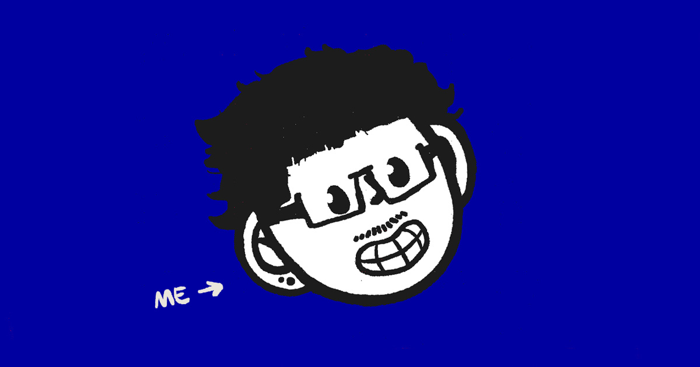

<div align="center">

<a href="https://cristhianmenezes.com.br">
  
</a>

# Cristhian Menezes :]

**Creative Developer** · tecnologia, design e cinema

Portfólio interativo em WebGL com uma cabeça ilustrada que reage ao mouse, rabiscos animados e uma página de links no estilo *link-in-bio*.

[](https://cristhianmenezes.com.br)
[](https://cristhianmenezes.com.br/links)
[](https://github.com/mennezs/cristhianmenezes.com.br/actions/workflows/deploy.yml)


</div>

---

## Sumário

- [Sobre o projeto](#sobre-o-projeto)
- [Estrutura do repositório](#estrutura-do-repositório)
- [Rodando localmente](#rodando-localmente)
- [Editando o conteúdo](#editando-o-conteúdo)
- [Página de links](#página-de-links)
- [Ícones e PWA](#ícones-e-pwa)
- [Deploy](#deploy)
- [Problemas conhecidos](#problemas-conhecidos)
- [Créditos](#créditos)

## Sobre o projeto

Este repositório guarda a **versão compilada de produção** do site [cristhianmenezes.com.br](https://cristhianmenezes.com.br). O app original foi feito com **Vite + Vue 3 + Three.js** e o código-fonte (`.vue`, shaders, config do Vite) fica em outro lugar.

Por isso, aqui **não existe** `package.json`, etapa de build, linter nem testes. O que está em `site/` é publicado do jeito que está.

| | |
|---|---|
| **Cena 3D** | Cabeça ilustrada em WebGL, montada a partir de *sprite sheets*, com mão, rabiscos, ruído e pós-processamento |
| **Interface** | Componentes Vue 3, rotas com vue-router, animações GSAP e rolagem com OverlayScrollbars |
| **Identidade** | Fonte *Comic CAT*, fundo `#0000a0`, cartões `#1c1c1c` e easing elástico |
| **Links** | Página `/links/` escrita à mão, sem framework |

## Estrutura do repositório

```text
.
├── .github/workflows/deploy.yml   # deploy automático via FTPS
├── .cpanel.yml                    # deploy alternativo pelo Git do cPanel
└── site/                          # raiz pública do site
    ├── index.html                 # monta o app Vue em #app + meta tags SEO/OG
    ├── assets/
    │   ├── main.js                # app inteiro em um único módulo ES (~40 mil linhas)
    │   ├── main.css
    │   └── tweakpane*.js          # carregados só pelo painel de debug
    ├── webgl/textures/            # texturas da cena Three.js
    ├── images/  videos/  fonts/   # mídia da interface e a fonte Comic CAT
    ├── icons-app/                 # ícones PWA / tela inicial
    ├── links/                     # página link-in-bio
    ├── site.webmanifest
    └── social-share.jpg           # imagem de compartilhamento (Open Graph)
```

### Como o `main.js` está organizado

O bundle foi formatado com Prettier e dividido por comentários-banner. Os identificadores continuam minificados (`n`, `e`, `Oe`…), então **procure por textos literais ou classes CSS**, não por nomes de variáveis.

| Banner | Conteúdo |
|---|---|
| `[LIB-1]` a `[LIB-7]` | Bibliotecas de terceiros (Vue, vue-router, Three.js, postprocessing, GSAP, OverlayScrollbars). **Não editar.** |
| `[SITE-1]` | Lista de texturas WebGL |
| `[SITE-2]` / `[SITE-4]` | Motor WebGL: classes base, entidades, utilitários e detecção de dispositivo |
| `[SITE-3]` | Painel de debug (Tweakpane) |
| `[SITE-5]` | Cena: cabeça, mão, rabiscos, shaders e efeitos |
| `[SITE-6]` | Inicialização do WebGL e componente raiz |
| `[SITE-7]` | Componentes Vue da interface |
| `[SITE-8]` | Seção **Sobre** (nome, descrição, contatos) |
| `[SITE-9]` | **Lista de projetos** |
| `[SITE-10]` | Layout dos projetos e player de vídeo/celular |
| `[SITE-11]` | Rotas e montagem do app |

## Rodando localmente

Os caminhos dos assets são absolutos a partir da raiz (`/assets/...`, `/images/...`), então sirva a pasta `site/` como raiz. Abrir o `index.html` direto pelo navegador (`file://`) **não funciona**.

```sh
cd site
python3 -m http.server 8000
# ou: npx serve .
```

Depois abra <http://localhost:8000>.

## Editando o conteúdo

Tudo fica em `site/assets/main.js`. Use a busca do editor para pular até o banner:

| O que mudar | Onde |
|---|---|
| Nome, texto de apresentação, LinkedIn, site e e-mail | `[SITE-8]` |
| Projetos (`title`, `description`, `link`, mídia) | `[SITE-9]` |
| Caminhos das texturas 3D | `[SITE-1]` |
| Imagens e vídeos do player e dos botões | constantes de texto em `[SITE-10]` |
| Título, descrição e meta tags de compartilhamento | `site/index.html` |

> [!TIP]
> Para ligar o painel de ajustes (Tweakpane), troque para `this.isActive = !0` no construtor em `[SITE-3]`.

> [!IMPORTANT]
> Depois de editar, confira a sintaxe. Como o arquivo é um módulo ES, copie para `.mjs` antes de checar:
>
> ```sh
> cp site/assets/main.js /tmp/main.mjs && node --check /tmp/main.mjs
> ```

Mudanças maiores, como novas seções, layout ou shaders, pedem o projeto-fonte original e um novo build. Remendar o bundle não substitui isso.

## Página de links


Uma página *link-in-bio* em HTML puro, servida em [`/links/`](https://cristhianmenezes.com.br/links). Ela não depende do build Vue.

- **Conteúdo:** tudo vem de `window.LINKS_CONFIG` em [`site/links/config.js`](site/links/config.js): perfil, ícones sociais, botões, títulos de seção e rodapé.
- **Ícones:** ficam em `site/links/icons/`. Um `icon` vazio mostra um marcador tracejado com a inicial do item.
- **Fonte:** a Comic CAT não tem acentos. Por isso o `@font-face` dela vale só para ASCII (`unicode-range`), a [Comic Neue](https://fonts.google.com/specimen/Comic+Neue) cobre os acentos e `text-transform: uppercase` deixa as duas parecidas.

```js
// site/links/config.js
links: [
  {
    title: "Youtube",
    description: "Making of, experiments and projects",
    url: "https://www.youtube.com/@mennezs",
    icon: "icons/youtube-icon.png",
  },
],
```

## Ícones e PWA

| Arquivo | Uso |
|---|---|
| `site/icons-app/` | PNGs de 32, 192 e 512 px e uma versão *maskable* de 512 px, todos com fundo `#0000a0` opaco (o iOS pinta áreas transparentes de preto) |
| `site/apple-touch-icon.png` | 180 px na raiz, porque o iOS pede exatamente esse caminho |
| `site/site.webmanifest` | Manifesto do site principal (`start_url: /`) |
| `site/links/manifest.webmanifest` | Manifesto da página de links (`start_url: /links/`) |

## Deploy

Todo `push` na branch `main` que altera `site/**` dispara o workflow [`deploy.yml`](.github/workflows/deploy.yml), que envia `site/` para o servidor via **FTPS** usando [FTP-Deploy-Action](https://github.com/SamKirkland/FTP-Deploy-Action).

Configure estes *secrets* no repositório:

| Secret | Descrição |
|---|---|
| `FTP_SERVER` | Host do servidor |
| `FTP_USERNAME` | Usuário FTP |
| `FTP_PASSWORD` | Senha FTP |
| `FTP_PORT` | Porta (normalmente `21`) |

Também há um [`.cpanel.yml`](.cpanel.yml) para quem preferir o deploy pelo **Git Version Control** do cPanel.

## Problemas conhecidos

- `/images/ctas/tex-ui-switch-fe-off.webp` também existe em `videos/`. O bundle usa a cópia em `images/ctas/`, então não a remova.
- Parte do material herdado do projeto base ainda não foi trocada, como alguns vídeos em `videos/` e texturas ilustradas.

## Créditos

O site foi adaptado do portfólio de **[Adrien Lamy](https://adrienlamy.fr)**. A estrutura WebGL e boa parte da interface vêm do trabalho original dele.

Bibliotecas usadas: [Vue](https://vuejs.org) · [vue-router](https://router.vuejs.org) · [Three.js](https://threejs.org) · [postprocessing](https://github.com/pmndrs/postprocessing) · [GSAP](https://gsap.com) · [OverlayScrollbars](https://kingsora.github.io/OverlayScrollbars) · [Tweakpane](https://tweakpane.github.io/docs)

---

<div align="center">

<a href="https://cristhianmenezes.com.br"></a>

[Site](https://cristhianmenezes.com.br) · [Links](https://cristhianmenezes.com.br/links) · [LinkedIn](https://www.linkedin.com/in/cristhianmenezes) · [YouTube](https://www.youtube.com/@mennezs) · [Instagram](https://instagram.com/mennezzss) · [X](https://x.com/itsnotaskull)

</div>
